# SIMRS Go

Sistem Informasi Manajemen Rumah Sakit (SIMRS) dengan Rekam Medis Elektronik (ERM), ditulis dalam Go. Proses bisnis dan struktur datanya meniru **SIMKES Khanza**: nama database `sik`, tabel `pasien`, `reg_periksa`, `pemeriksaan_ralan`, `resep_obat`, `kamar_inap`, `billing`, dan seterusnya. Penomoran juga sama dengan Khanza: `no_rawat` `yyyy/MM/dd/NNNNNN`, No. RM 6 digit, dan nomor antrean per dokter/poli.

Aplikasi ini berupa satu file biner tanpa dependensi. Antarmukanya web, bisa dibuka dari browser mana pun di jaringan RS. Database yang dipakai MySQL atau MariaDB.

## Modul & alur

1. **Registrasi**
   - Pasien baru: No. RM otomatis, validasi NIK, cek NIK ganda.
   - Kunjungan: `no_rawat`, nomor antrean, status Baru/Lama (per RS dan per poli), biaya registrasi baru/lama, dan umur saat daftar.
   - Dokter dipilih sesuai jadwal hari itu.
   - Registrasi bisa dibatalkan selama belum ada tindakan.
2. **Rawat jalan / IGD (ERM)**
   - SOAP/CPPT dengan tanda vital dan peringatan alergi.
   - Diagnosa ICD-10 (prioritas, kasus baru/lama) dan prosedur ICD-9-CM.
   - Tindakan dengan tarif dari master.
   - E-resep, permintaan lab, dan riwayat kunjungan.
3. **Farmasi**: antrean resep → validasi (memotong stok depo dan mencatat `riwayat_barang_medis`; ditolak bila stok kurang) → penyerahan. Ada etiket dan stok opname depo.
4. **Laboratorium**: order → input hasil per parameter. Flag H/L dihitung otomatis dari nilai rujukan L/P. Hasil bisa dicetak.
5. **Rawat inap**
   - Masuk kamar dari ralan/IGD, pindah kamar, dan pulang dengan status pulang.
   - Lama inap dihitung ala Khanza (minimal 1 hari).
   - Tersedia peta kamar dan ketersediaan bed per bangsal/kelas.
6. **Kasir**
   - Billing gabungan: registrasi, tindakan, lab, obat, kamar, dan biaya tambahan.
   - Pembayaran ditolak bila resep/lab/radiologi belum selesai, operasi masih berlangsung, atau pasien masih dirawat.
   - Membuat nota RJ/RI lalu **mengunci** transaksi. Pembatalan hanya oleh admin.
7. **Radiologi**
   - Dokter mengirim permintaan dari ERM. No. order `PRyyyyMMddNNNN`, sama seperti Khanza.
   - Radiografer mencatat pelaksanaan dan parameter eksposi (proyeksi, kV, mAs, FFD, dosis). Komponen tarif (bagian RS, BHP, jasa dokter/petugas, KSO, manajemen) disalin ke `periksa_radiologi`.
   - Gambar diunggah (JPG/PNG/WEBP/PDF, isi file diverifikasi). Dokter radiologi menulis expertise lalu hasil bisa dicetak.
   - Antrean dibagi 3 tab: menunggu pemeriksaan → menunggu bacaan → selesai.
8. **Kamar operasi / VK**
   - Penjadwalan (`booking_operasi`) dengan **cek bentrok ruang OK** per rentang jam. Status Menunggu → Proses Operasi → Selesai. Ada garis waktu per ruang.
   - Input tindakan dari `paket_operasi` (operasi maupun kebidanan) beserta tim: operator 1–3, asisten, instrumen, dokter anestesi, asisten anestesi, dokter anak, perawat resusitasi, bidan, perawat luar, omloop.
   - Jasa tiap peran ditagihkan hanya bila petugasnya diisi. Sewa OK, alat, akomodasi, bagian RS, dan sarpras selalu ditagihkan.
   - Tersedia laporan operasi (diagnosa pra/pasca bedah, jaringan, kirim PA, no. implan, uraian) yang bisa dicetak, serta obat/BHP kamar operasi.
9. **Bridging BPJS**
   - VClaim: cek peserta (kartu/NIK), rujukan, insert/hapus SEP, cetak SEP.
   - Antrean RS / Mobile JKN: tambah antrean, task id 1–7, batal.
   - Teknis: signature HMAC-SHA256, dekripsi AES-256-CBC, dan LZString. Semua panggilan dicatat ke log.
10. **SATUSEHAT (Kemenkes, FHIR R4)**
    - Mengikuti alur "Kirim SATUSEHAT" Khanza, dengan tabel yang sama: `satu_sehat_encounter`, `satu_sehat_condition`, `satu_sehat_procedure`, `satu_sehat_observationttv*`, `satu_sehat_mapping_lokasi_ralan/ranap`, dan `pegawai.no_ktp` untuk NIK dokter.
    - Urutan kirim: **Encounter** (arrived; AMB/EMER/IMP) → **Condition** ICD-10 → **Procedure** ICD-9-CM → **Observation** tanda vital (nadi, napas, suhu, tensi sistolik/diastolik, TB, BB, lingkar perut; LOINC + UCUM) → **Encounter finished** dengan diagnosis dan riwayat status.
    - Tahap 2 (tabel Khanza `satu_sehat_medication*`, `satu_sehat_servicerequest_*`, `satu_sehat_specimen_lab`, `satu_sehat_observation_lab`, `satu_sehat_diagnosticreport_*`):
      - **Obat**: Medication (kode KFA) → MedicationRequest dari e-resep (frekuensi dan dosis dibaca dari aturan pakai, mis. "3x1", "2 x 1/2") → MedicationDispense setelah validasi farmasi, dari lokasi depo farmasi.
      - **Lab**: ServiceRequest (LOINC) → Specimen (SNOMED-CT) saat sampel diambil → Observation hasil (angka + UCUM, atau teks; nilai rujukan dan flag H/L) → DiagnosticReport.
      - **Radiologi**: ServiceRequest (LOINC, ACSN = no. order) → DiagnosticReport berisi expertise.
      - Mapping KFA, LOINC, spesimen, dan lokasi depo diisi di tab **Mapping obat/lab/radiologi**. Mapping LOINC untuk parameter lab contoh sudah terisi. Item yang belum di-mapping dilewati dengan peringatan tanpa menghalangi Encounter finished.
    - Encounter diselesaikan setelah kasir lunas (rawat jalan) atau pasien pulang (rawat inap).
    - IHS pasien/dokter dicari lewat NIK lalu disimpan. Token OAuth2 diperbarui otomatis.
    - Location poli/kamar bisa dibuat langsung dari halaman mapping.
    - Pengiriman bisa per kunjungan, "kirim semua", atau otomatis berkala (`SATUSEHAT_AUTO_MENIT`). Aman diulang karena data yang sudah terkirim tidak dikirim lagi.
    - Penyebab gagal (NIK kosong, lokasi belum di-mapping, pesan OperationOutcome) tampil per kunjungan, dan semua panggilan dicatat di log.
11. **Logistik farmasi (pengadaan)**
    - Supplier (`datasuplier`), surat pemesanan (`surat_pemesanan_medis`, bisa dicetak) → penerimaan faktur (`pemesanan`/`detailpesan`, diskon per item, PPN, meterai, no. batch, kedaluwarsa, harga beli master ikut diperbarui).
    - Stok masuk ke gudang farmasi lalu dimutasi ke depo (`mutasibarang`), ditolak bila stok asal kurang. Ada peringatan stok depo di bawah minimal.
    - Stok opname dengan nilai selisih (`opname`), kartu stok per barang/lokasi dari `riwayat_barang_medis`, dan daftar batch yang kedaluwarsa dalam 180 hari.
12. **Keuangan & akuntansi**
    - Bagan akun (`rekening`), jurnal otomatis yang selalu seimbang (`jurnal`/`detailjurnal`) dari: pembayaran kasir (pendapatan per kelompok billing, kas atau piutang penjamin), HPP obat, penerimaan faktur (persediaan, PPN masukan, hutang), bayar hutang, dan bayar piutang. Akun diatur di **Setelan akun**.
    - Pembatalan nota oleh admin membuat jurnal balik, dan ditolak bila piutangnya sudah dicicil.
    - Piutang pasien per penjamin dengan umur piutang (0–30, 31–60, 61–90, >90 hari), pembayaran klaim/cicilan, diskon, dan penghapusan piutang tak tertagih.
    - Hutang supplier per jatuh tempo (yang lewat ditandai), pembayaran sebagian atau lunas.
    - Jurnal umum manual, buku besar, neraca saldo, laba rugi, dan neraca (dengan laba ditahan).
13. **Gizi**
    - Diet pasien rawat inap per tanggal dan waktu makan (`diet`, `detail_beri_diet`, `jam_diet_pasien`), dengan peringatan alergi dan pasien yang belum punya diet.
    - Salin diet dari hari sebelumnya (memakai kamar terbaru bila pasien pindah), rekap porsi per waktu/diet/bangsal untuk dapur, dan cetak etiket.
14. **Laporan**: kunjungan per poli (baru/lama, BPJS/non), 10 besar penyakit, pemeriksaan radiologi, tindakan operasi/VK, pendapatan, obat terbanyak, indikator BOR/ALOS/TOI/BTO/GDR, dan ekspor CSV.
15. **Pengguna & keamanan**
   - Login dengan peran: admin, pendaftaran, dokter, perawat, farmasi, lab, radiologi, ok (kamar operasi), gizi, kasir, keuangan, bpjs, manajemen.
   - Password bcrypt, sesi di database, token CSRF di setiap form, dan audit log.

## Tampilan (INA Digital Design System)

Antarmuka mengikuti [INA Digital Design System (IDDS)](https://design.inadigital.go.id), standar desain layanan digital pemerintah:
- Token warna, radius, bayangan, dan spacing disalin dari paket resmi `@idds/react`. Font **Inter** dan ikon **Tabler** ditanam di biner, jadi tetap tampil tanpa internet.
- Tema merek dipilih lewat `UI_BRAND` di `simrs.env`: `inagov` (bawaan, biru), `panrb`, `bkn`, `lan`, `bgn`, `inaku`, `inapas`, atau `netral`.
- Komponen yang dipakai mengikuti pola IDDS: sidebar putih berkelompok, kartu ringkasan berikon, tombol primer/sekunder, text field dengan label di atas, tab, badge, alert, dan tabel.
- Aksesibilitas: tautan "Lewati ke konten", fokus keyboard terlihat, `aria-current` di menu, `role="alert"` pada pesan galat, dan kontras warna mengikuti token IDDS.
- Responsif: di layar kecil sidebar menjadi drawer.

Aplikasi ini memakai CSS sendiri yang mengikuti token IDDS, bukan komponen React IDDS, karena antarmukanya dirender di server (Go `html/template`).

## Instalasi

```bash
# 1. database
mysql -u root -e "CREATE DATABASE sik CHARACTER SET utf8mb4; CREATE USER 'simrs'@'localhost' IDENTIFIED BY 'ganti-password'; GRANT ALL ON sik.* TO 'simrs'@'localhost';"
# 2. konfigurasi
cp simrs.env.example simrs.env   # isi DB_PASS, SESSION_SECRET, ADMIN_PASSWORD
# 3. buat tabel + data master contoh, lalu jalankan
./simrs -migrate
./simrs
```

Setelah itu buka `http://localhost:8090` dan login sebagai `admin`. Setelah login pertama, hapus `ADMIN_PASSWORD` dari `simrs.env`. Untuk mengganti password lewat terminal: `./simrs -set-password admin` (password diketik di terminal).

Gambar radiologi disimpan di folder `UPLOAD_DIR` (bawaan `uploads`). Ikutkan folder ini saat backup bersama database. Gambar DICOM dari modalitas/PACS belum didukung; unggah hasil ekspor JPG/PNG atau PDF.

Di Windows, gunakan `simrs.exe` dengan MariaDB/XAMPP. Biner untuk Linux dan Windows tersedia di halaman Releases.

### Membangun dari sumber
```bash
go build -o simrs .
GOOS=windows GOARCH=amd64 go build -o simrs.exe .
```

## Bridging BPJS

Kredensial (cons-id, secret, user key) diisi hanya di `simrs.env` di server, tidak pernah lewat antarmuka web.

- `BPJS_MODE=mock`: menjalankan **server tiruan lokal** yang memverifikasi signature dan mengenkripsi respons seperti server BPJS. Cocok untuk latihan dan demo. Kartu contoh: `0001234567890`, `0001234567891`, `0001234567892`. Kartu `0009999999999` berstatus nonaktif.
- `BPJS_MODE=dev`: memakai server development BPJS (butuh kredensial dev dari BPJS).
- `BPJS_MODE=prod`: memakai server produksi.

Mapping kode: `poliklinik.kd_poli_bpjs` dan `dokter.kd_dokter_bpjs` harus diisi dengan kode referensi BPJS.

## SATUSEHAT

1. Daftarkan RS di portal SATUSEHAT Kemenkes untuk mendapatkan Organization ID, Client ID, dan Client Secret (lingkungan dev/staging dulu).
2. Isi `SATUSEHAT_MODE`, `SATUSEHAT_CLIENT_ID`, `SATUSEHAT_CLIENT_SECRET`, dan `SATUSEHAT_ORG_ID` di `simrs.env`, lalu restart.
3. Login sebagai admin atau peran `bpjs`, buka **SATUSEHAT → Mapping**. Isi NIK setiap dokter, lalu isi atau **Buat** Location untuk tiap poli dan kamar.
4. Untuk obat/lab/radiologi: buka tab **Mapping obat/lab/radiologi**, isi kode KFA tiap obat, cek LOINC lab/radiologi, dan buat Location depo farmasi.
5. Pastikan pasien punya NIK. Kirim dari tab **Kirim data**, atau aktifkan `SATUSEHAT_AUTO_MENIT`.

## Pengujian

```bash
go test ./...
```

Pengujian memakai database `sik_test`. Atur `SIMRS_TEST_DSN` atau siapkan user `simrs`. Cakupan:

- **Inti**: alur lengkap ralan dan ranap, termasuk tarif, stok, kunci kasir, dan 20 registrasi paralel.
- **Web**: semua peran, RBAC, CSRF, setiap halaman, unggah gambar (file palsu ditolak, path traversal 404), dan penelusuran semua tautan di halaman utama untuk menangkap URL rusak.
- **Logistik & keuangan**: SP → faktur (hitungan diskon/PPN/meterai) → mutasi → opname → bayar hutang; kasir tunai vs BPJS → piutang → klaim; setiap jurnal diperiksa seimbang, saldo akun dicocokkan angka per angka, neraca saldo dan neraca harus seimbang.
- **Gizi**: diet hanya untuk pasien yang sedang dirawat, salin diet memakai kamar baru setelah pindah kamar, tidak ada duplikasi saat disalin ulang.
- **SATUSEHAT**: alur ralan, IGD→ranap, token kedaluwarsa, idempotensi, pasien/dokter tanpa NIK, obat/lab/radiologi (termasuk item tanpa mapping dan depo belum di-mapping), dan server tiruan dipastikan menolak payload yang salah (KFA tidak valid, Observation lab tanpa Specimen, dsb.).
- **BPJS**: LZString, AES, dan signature dicocokkan dengan pustaka `lz-string` JavaScript dan Node `crypto`, plus tes klien terhadap server tiruan.

## Batasan

- Ini adalah subset dari Khanza (Khanza memiliki ratusan modul). Yang belum ada antara lain inventaris/logistik non-medis, kepegawaian dan penggajian, aset tetap/penyusutan, stok per batch (FEFO), INA-CBG grouper/E-Klaim, dan cetak berkas klaim.
- Bridging BPJS belum diuji ke server BPJS sungguhan. Yang sudah diuji hanya server tiruan dengan algoritme yang sama.
- SATUSEHAT juga baru diuji dengan server tiruan (`SATUSEHAT_MODE=mock`). Server tiruan ini memvalidasi aturan pokok: token, referensi, identifier unik, ICD/LOINC/UCUM, dan syarat finished. Server Kemenkes punya validasi lebih banyak, jadi uji dulu di `dev`/`stg` dengan kredensial RS sebelum `prod`. Resource yang belum dikirim: AllergyIntolerance (alergi di ERM masih teks bebas, belum berkode SNOMED), Composition/resume medis, ImagingStudy (butuh PACS/DICOM), obat racikan, dan Medication untuk BHP non-KFA.
- Akuntansi memakai bagan akun contoh. Sesuaikan dengan bagan akun RS lewat menu Rekening dan Setelan akun sebelum dipakai.
- Bukan produk bersertifikat. Lakukan uji coba dan validasi sebelum dipakai untuk pelayanan nyata.

## Tangkapan layar

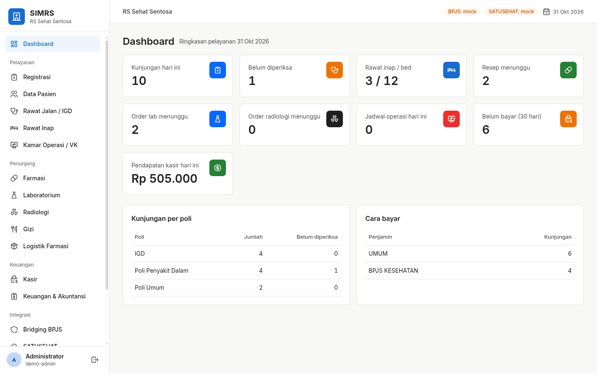

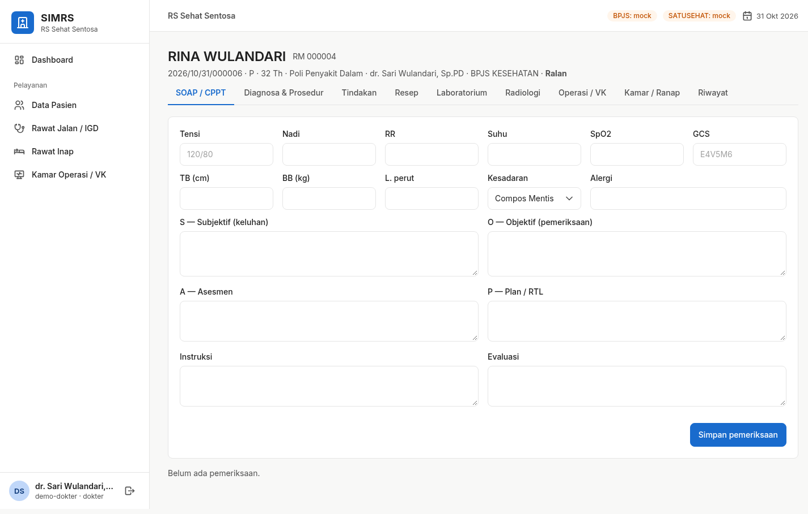
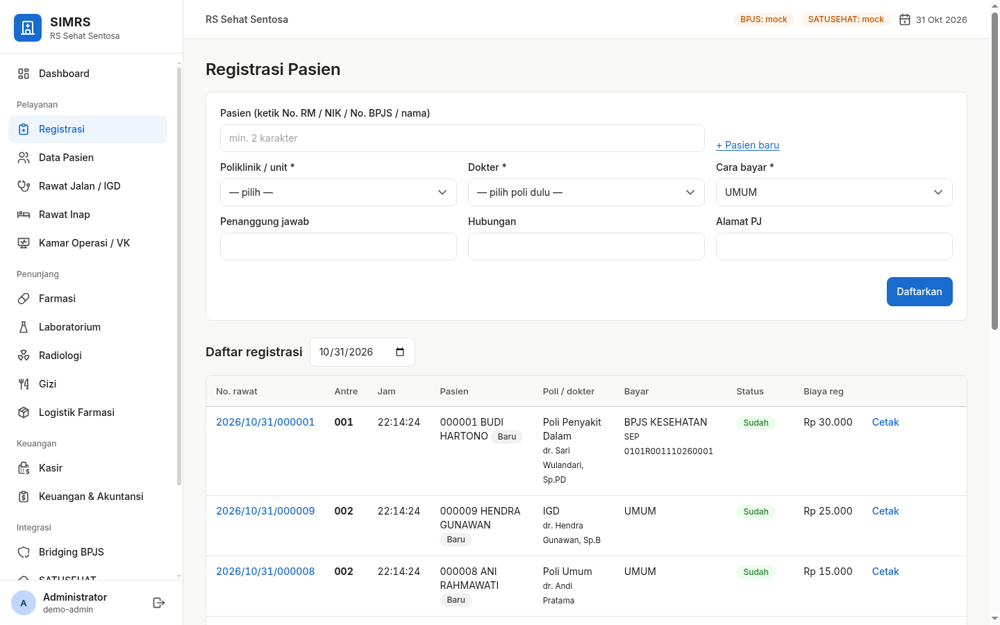
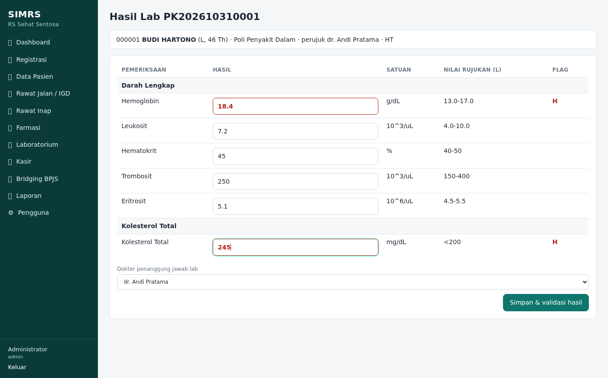
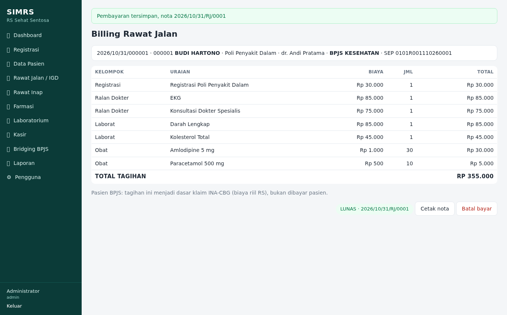
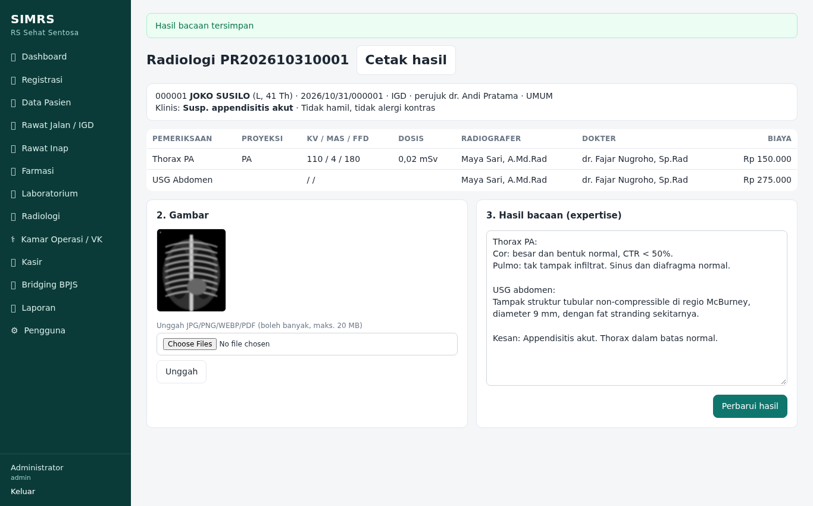
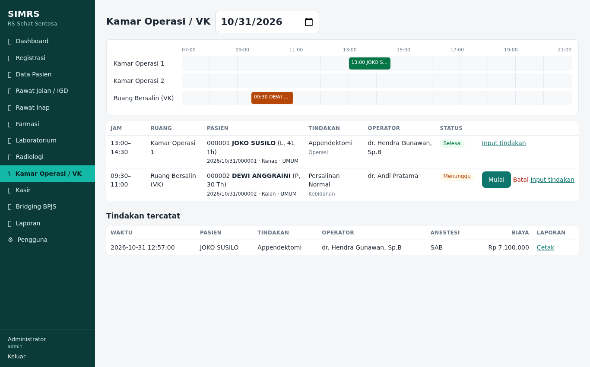
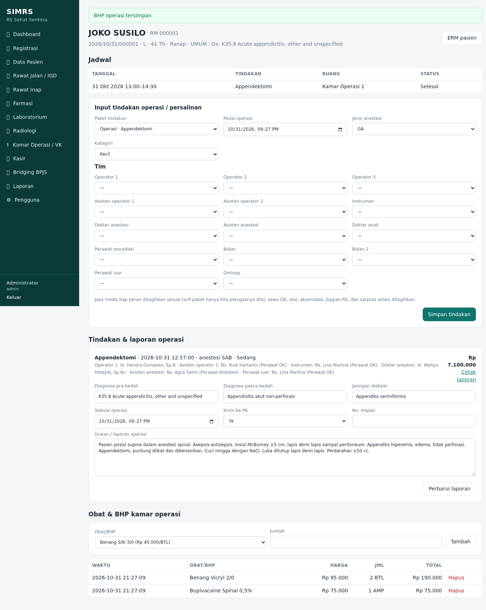
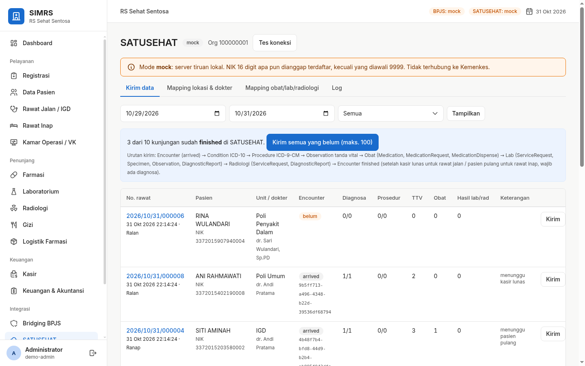
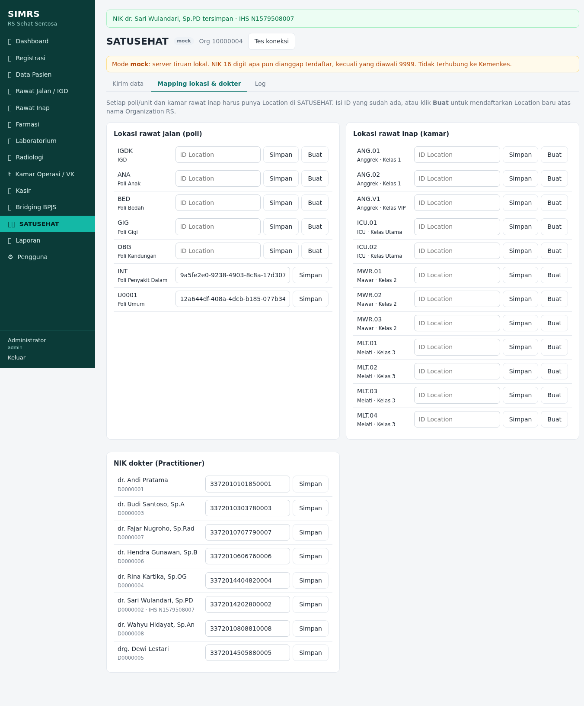
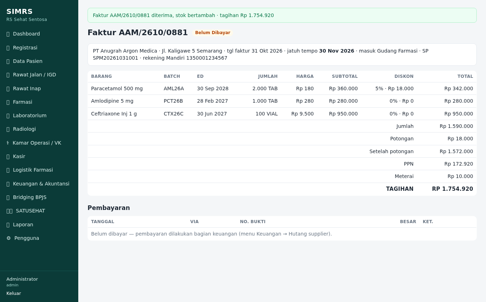
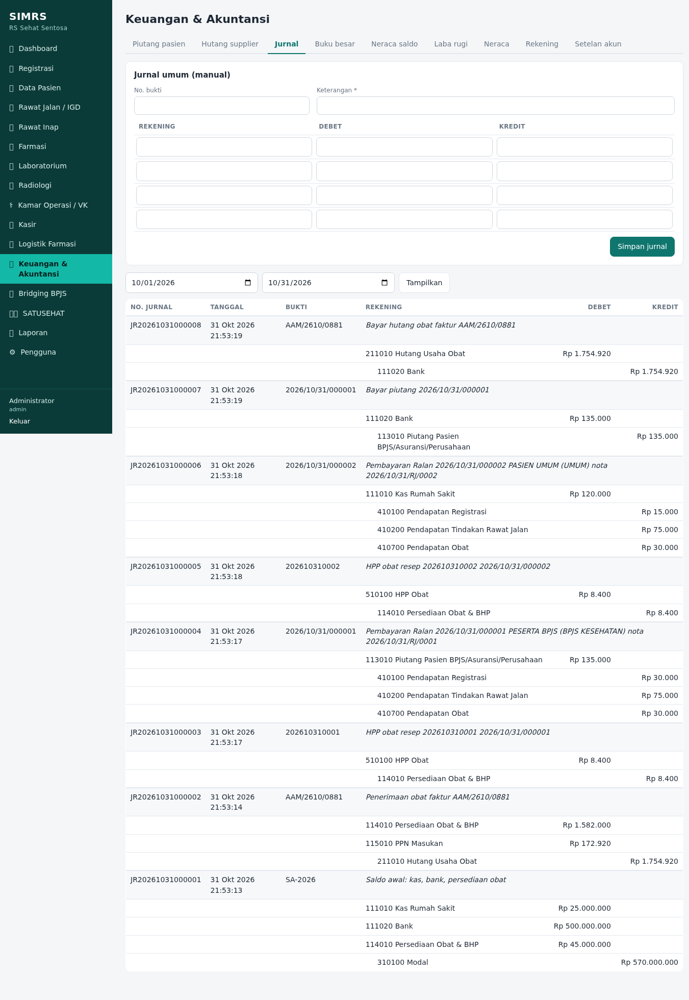
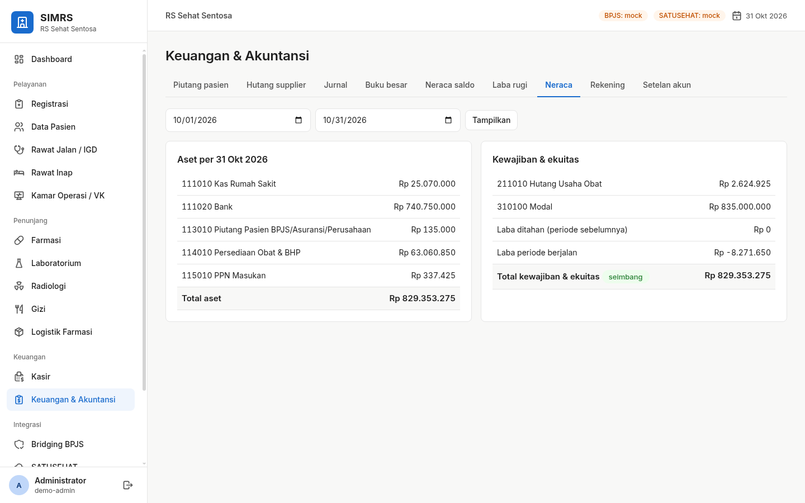
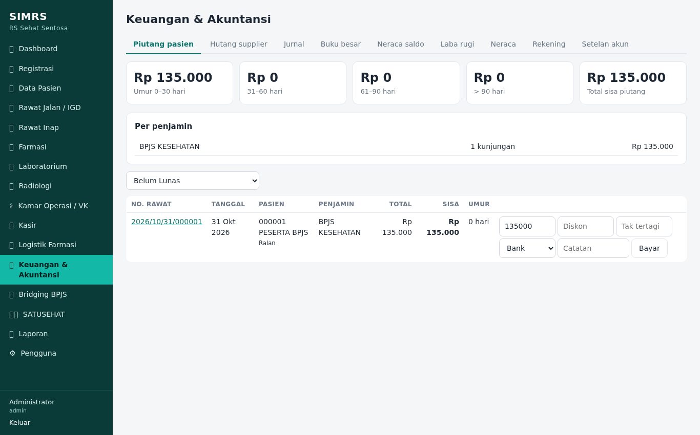
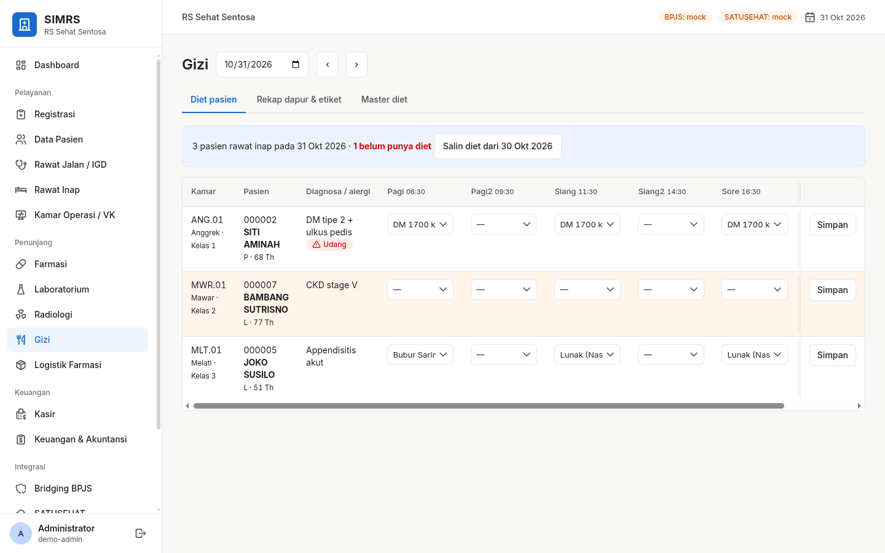
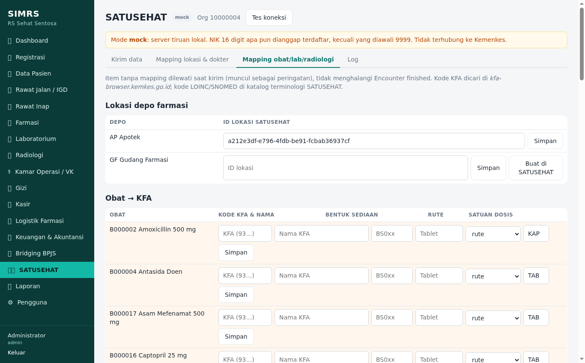
